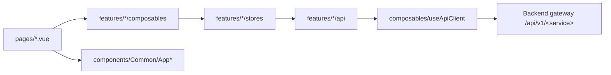

# Frontend architecture

Rules: [`.agents/rules/architecture.md`](../.agents/rules/architecture.md). This page describes the
current app and the target.

## Target

Features: `auth`, `journal`, `analytics`, `mt5-connection`, `market` (active); `strategies`, `ai-journal` (planned).
See [features-catalog.md](features-catalog.md).

## Current state

| Item | Purpose |
|---|---|
| `features/auth` | Sign-in/up, verify email, reset password; session store (access token in memory, refresh token in `localStorage`) |
| `features/journal` | Trades list and filters, report upload, account selector |
| `features/analytics` | Dashboard: KPIs, equity curve, calendar heatmap, symbols, hours, recent trades, trade chart and comparison |
| `features/mt5-connection` | EA bridge for all users (`api/bridge.ts` → `mt5-bridge`): ingest tokens, EA download, setup guide, bridge accounts; legacy admin-only link/sync/unlink of the open MT5 terminal (`api/mt5Api.ts` → `mt5`) |
| `features/market` | Real candles for charts; "No market data" when the terminal is unavailable |
| `pages/*.vue` | Thin route components composing features |
| `middleware/auth.global.ts` | Every page except login/register/verify-email/forgot/reset-password requires a session |
| `stores/i18n.ts`, `composables/useI18n.ts` | English/Spanish translations |
| `composables/useApiClient.ts` | Envelope unwrap, `ApiError`, auth header, refresh-once on `UNAUTHENTICATED`; `getBlob` for authenticated binary downloads |

## Shared components (`components/Common/`)

| Component | Use |
|---|---|
| `AppButton` | Variants primary/secondary/danger/success/warning/subtle, sizes, loading |
| `AppInput` | Label, hint, error; eye toggle for passwords |
| `AppBadge` | Status pill (success/danger/warning/info/primary/neutral) |
| `AppMetricCard` | KPI card with tooltip, delta badge and optional `valueClass` for sign colouring |
| `AppModal` / `AppConfirmDeleteModal` | Dialog / typed double confirmation for deletes |
| `AppEmptyState` | Empty view with CTA |
| `AppPagination` | Page controls + page size; props `currentPage`, `pageSize`, `totalItems`; emits `change` |
| `AppSkeleton` | Loading placeholder (`height`, `width`) |
| `AppTooltip` | Metric definitions |
| `AppHeader` / `AppSidebar` / `AppThemeToggle` | Shell, navigation, theme |

## Configuration

| Variable | Default |
|---|---|
| `NUXT_PUBLIC_API_BASE_URL` | empty (same origin; the dev server proxies `/api/v1/<service>`) |
| `NUXT_PUBLIC_API_VERSION` | `v1` |
| `NUXT_AUTH_URL` / `NUXT_JOURNAL_URL` / `NUXT_ANALYTICS_URL` / `NUXT_MT5_URL` | dev proxy targets, default `http://localhost:8001` / `8002` / `8003` / `8004` |
| `NUXT_BRIDGE_URL` | dev proxy target of `mt5-bridge` (`/api/v1/mt5-bridge`), default `http://localhost:8005` |
