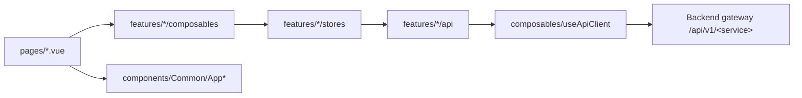

# Frontend architecture

Rules: [`.agents/rules/architecture.md`](../.agents/rules/architecture.md). This page describes the
current app and the target.

## Target

Features (planned): `auth`, `journal`, `analytics`, `mt5-connection`, `strategies`, `ai-journal`.
See [features-catalog.md](features-catalog.md).

## Current state (legacy until frontend spec 001)

| Item | Purpose |
|---|---|
| `pages/index.vue` | Landing / navigation |
| `pages/upload.vue` | MT5 report upload (CSV/XLSX) |
| `pages/journal.vue` | Dashboard: KPIs, equity curve, calendar heatmap, trades table, MT5 account switcher |
| `stores/analytics.ts` | Analytics + trades + upload (calls `$fetch` directly) |
| `stores/mt5.ts` | MT5 accounts (legacy backend `/api/v1/mt5`) |
| `stores/i18n.ts`, `composables/useI18n.ts` | English/Spanish translations |
| `composables/useTheme.ts` | Dark/light theme |
| `composables/useTradeComparison.ts` | Multi-chart comparison state |
| `components/Analytics/*` | KPI cards, charts (Plotly, Lightweight Charts), tables, modals |

## Shared components (`components/Common/`)

| Component | Use |
|---|---|
| `AppButton` | Variants primary/secondary/danger/success/warning/subtle, sizes, loading |
| `AppInput` | Label, hint, error; eye toggle for passwords |
| `AppBadge` | Status pill (success/danger/warning/info/primary/neutral) |
| `AppMetricCard` | KPI card with tooltip and delta badge |
| `AppModal` / `AppConfirmDeleteModal` | Dialog / typed double confirmation for deletes |
| `AppEmptyState` | Empty view with CTA |
| `AppPagination` | Page controls + page size; props `currentPage`, `pageSize`, `totalItems`; emits `change` |
| `AppSkeleton` | Loading placeholder (`height`, `width`) |
| `AppTooltip` | Metric definitions |
| `AppHeader` / `AppSidebar` / `AppThemeToggle` / `AppAuthCard` | Shell, navigation, theme, auth |

## Configuration

| Variable | Default |
|---|---|
| `NUXT_PUBLIC_API_BASE_URL` | `http://localhost:8000` |
| `NUXT_PUBLIC_API_VERSION` | `v1` |
